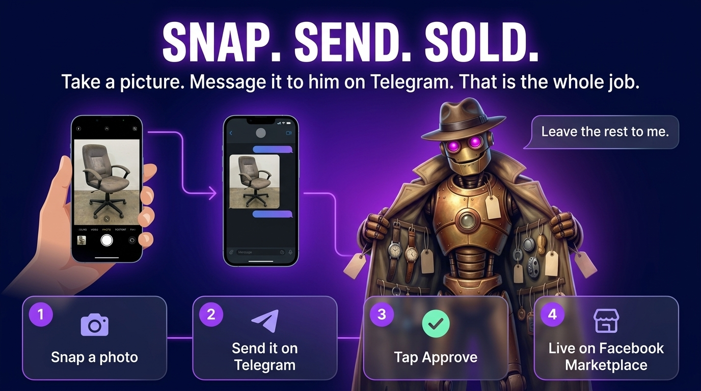
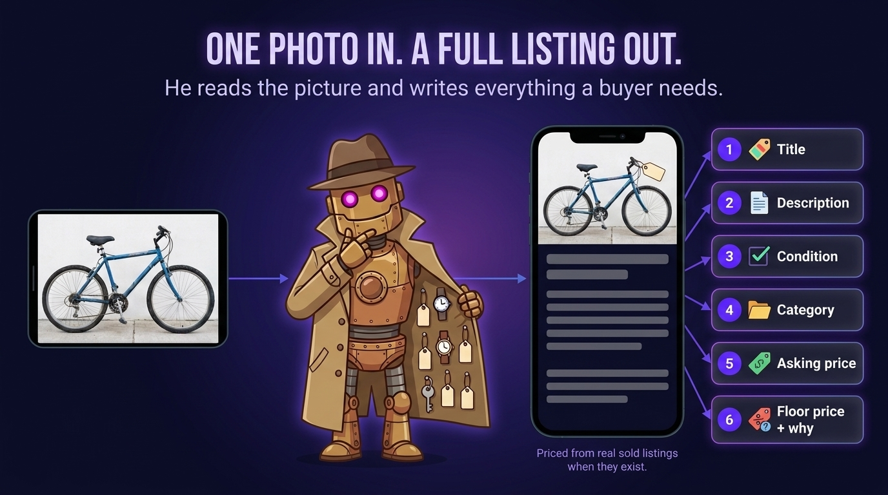
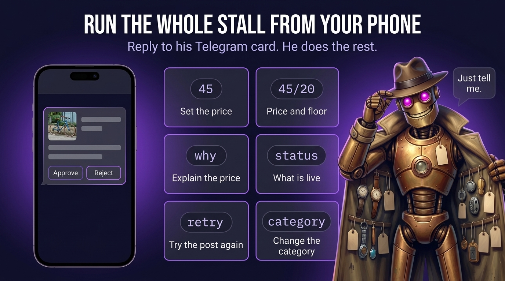
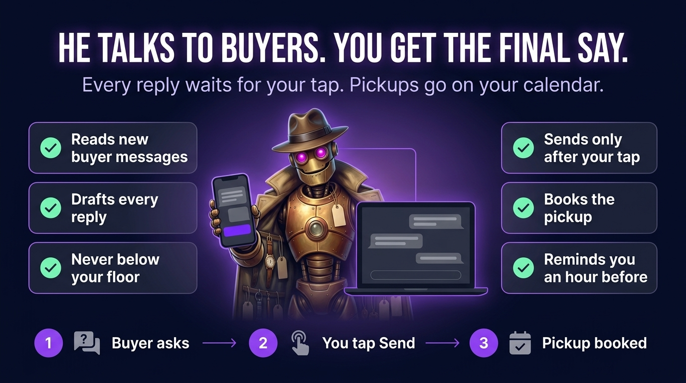

# Agent Sell Stuff

**Snap a photo. Message it to him on Telegram. He writes the listing, prices it, posts it to Facebook Marketplace, and answers your buyers. You approve every word.**



"He" is a small agent that lives in two places: a Cloudflare Worker in the
cloud, and a poster program on a computer you own. You only ever talk to the
Telegram bot.

> **Heads up.** Automating Facebook Marketplace may break Facebook's terms.
> Use it on your own account at your own risk.

## What it does



- **Takes photos from Telegram.** Send one item's photos in one message. Add a
  caption if you want to tell it something ("works, small scratch, want $40
  minimum").
- **Writes the listing.** One Claude call looks at the photos and returns a
  title, a description, a condition, a Facebook category, an asking price and a
  floor price (the lowest you'd take), plus its reasoning.
- **Asks you first.** You get an approve card in Telegram with the photo, the
  price and two buttons. Nothing is ever posted without your tap.
- **Posts it.** A program on your own computer opens your real, logged-in
  Chrome and fills in the Facebook Marketplace form, one listing at a time, at
  human speed. Facebook has no listing API for individuals, so a browser is the
  only way.
- **Looks after it.** Edits the price on a live listing, deletes a listing when
  you say so, proposes a 10% price drop after a week, and nudges you about
  cards you never tapped.
- **Talks to your buyers.** When someone messages about a listing, he reads it,
  drafts a reply and sends you both on Telegram. Tap **Send**, tap **Skip**, or
  reply to the card with your own words. Nothing reaches a buyer without you.
- **Sets up the pickup.** Once a buyer wants it, he offers times inside your
  hours at the spot you choose. When they agree, the confirmation card books
  it: a Google Calendar link, a reminder an hour before, and a "did it sell?"
  card afterwards that logs the sale and takes the listing down.
- **Asks instead of guessing.** Any judgement call (which of two similar
  listings is this one? is it already gone?) comes to you as a Telegram
  question with buttons.

```
 you ──photos──> Telegram bot ──webhook──> Cloudflare Worker ──> Claude
                                              │  photos in R2, items in D1
          approve card (Approve / Reject) <───┘
 you ──tap Approve──>  Worker marks the item "approved"
                                              ▲
 your computer: poster ──claim one item──────┘   (shared secret)
   └─> your real Chrome ──> Facebook Marketplace ──> reports back "posted"

 buyer messages ──> poster reads the inbox ──> Worker drafts a reply
          reply card (Send / Skip / your own words) <───┘
 you ──tap Send──> poster types it into that chat ──> pickup booked + reminder
```

## What you need

- A Telegram account.
- A Cloudflare account (the free plan to start; Workers, D1 and R2 are used).
- An Anthropic API key with a little credit on it.
- A computer that stays on, with **Google Chrome** and **Node.js 20+**. The
  install script is for Windows (PowerShell). On Mac or Linux, run
  `node poster.mjs` under any process manager you like.
- A Facebook account you can sign into by hand once.

## Setup

About 20 minutes. Prefer to have a coding agent do it? Paste
[`KIT.md`](KIT.md) into Claude Code, Codex or Cursor.

1. **Make the Telegram bot.** In Telegram, message **@BotFather**, send
   `/newbot`, and follow the prompts. Keep the bot token it gives you. Invent a
   random string (letters, digits, `_` and `-`) for the webhook secret.
2. **Get the code and install.**
   ```
   git clone <this repo>
   cd sellstuff
   npm install
   ```
3. **Create the Cloudflare pieces.**
   ```
   npx wrangler login
   npx wrangler d1 create sellstuff
   npx wrangler r2 bucket create sellstuff-photos
   ```
   Copy the `database_id` that `d1 create` prints into `wrangler.toml`. Then
   build the tables:
   ```
   npm run db:init
   ```
4. **Deploy.**
   ```
   npx wrangler deploy
   ```
   Note the URL it prints. Uncomment `WORKER_URL` in `wrangler.toml`, put that
   URL in, and deploy once more.
5. **Set the secrets.** Each command asks you to paste the value.
   ```
   npx wrangler secret put ADMIN_KEY                 # long random string, you invent it
   npx wrangler secret put IMG_TOKEN                 # another long random string
   npx wrangler secret put TELEGRAM_BOT_TOKEN        # from BotFather
   npx wrangler secret put TELEGRAM_WEBHOOK_SECRET   # the string from step 1
   npx wrangler secret put ANTHROPIC_API_KEY         # from console.anthropic.com
   ```
   To make a random string:
   `node -e "console.log(require('crypto').randomBytes(24).toString('hex'))"`
6. **Point Telegram at the Worker.**
   ```
   curl -X POST https://YOUR_WORKER_URL/admin/set-webhook -H "Authorization: Bearer YOUR_ADMIN_KEY"
   ```
   The answer should say `"ok": true`.
7. **Tell the bot who you are.** Send your bot any message. It replies with
   your chat id. Set it (it takes effect right away):
   ```
   npx wrangler secret put TELEGRAM_CHAT_ID
   ```
   From now on the bot ignores everyone else.
8. **Install the poster on your computer.**
   ```
   cd poster
   copy .env.example .env      (Mac/Linux: cp .env.example .env)
   ```
   Edit `.env`: your Worker URL and the same `ADMIN_KEY` from step 5. Then:
   ```
   npm install
   node login.mjs
   ```
   A Chrome window opens. **Sign into Facebook yourself, once.** The kit never
   sees your password. Then register the poster to start at logon:
   ```
   powershell -ExecutionPolicy Bypass -File install.ps1
   ```
9. **Try it.** Send the bot photos of something you want to sell. In a minute
   you get a card. Tap Approve. To watch the poster fill the form without
   publishing, run `node poster.mjs --once --dry` from the `poster` folder
   after approving. Then text the bot `spot` and `hours` (see
   [Talking to buyers](#talking-to-buyers)) so pickups land where and when you
   want.

Already running an older copy? Pull, run `npm run db:buyers`, deploy, and
restart the poster.

## Commands



Text these to your bot. Reply to a card to aim at that item; otherwise it uses
the most recent one.

| You send | What happens |
|---|---|
| photos (one message) | New listing: researched, priced, card sent |
| `250` or `$250` | Set the asking price (a live listing gets edited on Facebook) |
| `floor 100` | Set your walk-away price |
| `250/100` | Both at once |
| `why` | How it landed on that price. Free and instant |
| `status` | What is live, waiting, or stuck, and why |
| `retry` | Put a listing it gave up on back in the queue |
| `redo` | Run the research again |
| `category Tools` | Change the category |
| `sold 40` | Log a sale |
| `remove` (as a reply to a card) | Delete the listing from Facebook. A delete, never "mark as sold" |
| your own words (as a reply to a buyer card) | Sends exactly what you typed instead of the draft |
| `spot Starbucks on 5th Ave` | Where pickups happen. Buyers never get your address |
| `hours weekdays 6-8pm, Sat 10-2` | When you can meet. Pickup times are only offered inside these |
| `meetups` | Upcoming pickups |
| `buyers` | Replies waiting on you, queued, or failed |
| anything else | A real conversation about the item. It only changes a price if you tell it to |

## Talking to buyers



Set two things once, by texting your bot:

```
spot Starbucks on 5th Ave
hours weekdays 6-8pm, weekends 10am-4pm
```

Then every new buyer message turns into a card with their words and a draft
reply. The draft answers from your listing, counters lowball offers without
going under your floor, and never gives out your address. If the buyer tries
something odd (a payment link, a "verification code"), the draft is a polite no
and the card tells you why.

When a buyer agrees to a time, the card says **Send + book pickup**. One tap
sends the confirmation and books it.

## Guardrails

- **You approve every listing and every reply.** Nothing is posted or sent
  without your tap.
- **Paced like a person.** One thing at a time, a few minutes between
  listings, random pauses and per-character typing. The daily ceiling is
  yours to set (`MAX_POSTS_PER_DAY`).
- **Three failures park an item** until you send `retry`, instead of retrying
  in a loop.
- **Kill switch.** Set `AUTO_POST_FB = "off"` in `wrangler.toml` and run
  `npx wrangler deploy`.
- **Your real account only.** Never a second or burner account.
- **Private by default.** The bot answers only your chat id. The Worker's admin
  routes need your `ADMIN_KEY`. Photos are served only with your `IMG_TOKEN`.

More in [`docs/SAFETY.md`](docs/SAFETY.md).

## What it costs

Cloudflare Workers, D1 and R2 are cheap and have free allowances. Telegram is
free. The only metered thing is Claude: one call per new listing (the photos
are most of the cost), and a small text-only call per buyer message or when you
chat about an item.
Typing `why`, `status`, a price, or any other command costs nothing. Check your
chosen model's price page for the exact numbers.

## What is in the box

```
worker/src/index.js        the Worker (Telegram, state, pricing, claim queue)
worker/src/inbox.js        buyer messages, reply cards, pickups and reminders
poster/                    runs on your computer
  poster.mjs               claim -> post / edit / delete -> report loop, then buyers
  fb.mjs                   the Marketplace form driver
  inbox.mjs                reads Marketplace chats, types replies you approved
  match.mjs (+ test)       matches your listing to a card on Your listings
  login.mjs                one-time Facebook sign-in
  install.ps1              start-at-logon, -Status, -Resume, -Uninstall
  backfill-permalinks.mjs  repairs missing listing links
migrations/                the database (0001 listings, 0002 buyers + pickups)
wrangler.toml              Worker config with placeholders
docs/                      how it works, safety, API, troubleshooting
AGENTS.md                  paste into a coding agent to set it all up
KIT.md                     the shortcut version of that
```

## Docs

- [`docs/HOW-IT-WORKS.md`](docs/HOW-IT-WORKS.md) the whole chain, step by step
- [`docs/SAFETY.md`](docs/SAFETY.md) the rules and where each one is enforced
- [`docs/API.md`](docs/API.md) the Worker's routes
- [`docs/TROUBLESHOOTING.md`](docs/TROUBLESHOOTING.md) when it goes quiet

## Not done

Mercari and OfferUp are not in this kit. eBay is not either; only Facebook
Marketplace is wired up.

## License

MIT. See [`LICENSE`](LICENSE).
